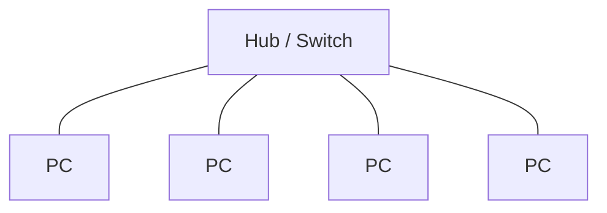
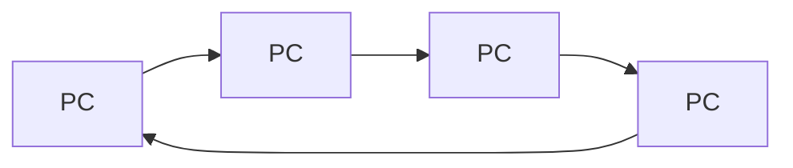
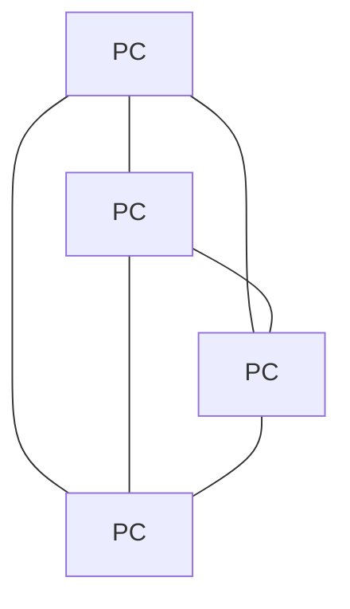
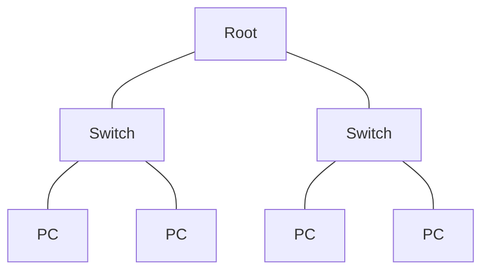

# Network Topologies

#computer #networking #topology

## How this note is ranked

Your 206-question set has **no direct topology question**. It does have related network questions (network types, VPN, node), marked 📌 below. So the ranking here is based on **what competitive exams usually ask** about topology, plus those related questions. Nobody can promise the exact paper, so use the tiers like this:

|Tier|Meaning|What to do|
|---|---|---|
|⭐⭐⭐ **Must know**|the six topologies and their one defining fact|learn first, aim for 100%|
|⭐⭐ **Good to know**|advantages, disadvantages, examples, network types|learn after Tier 1|
|⭐ **Skip for now**|standards and exact formulas|read only if everything else is done|

---

# ⭐⭐⭐ Tier 1: Must know

## 1. What is topology

**Network topology** = the **layout (arrangement)** of devices (nodes) and the links that connect them.

Six types: **Bus, Star, Ring, Mesh, Tree, Hybrid.**

## 2. The six topologies in one table

|Topology|How it is connected|One defining fact|
|---|---|---|
|**Bus**|all devices on **one common cable** (backbone)|cheapest, **cable break stops the whole network**|
|**Star**|every device joins a **central hub or switch**|**most common today**, easy to add devices|
|**Ring**|devices in a **circle**, each linked to two neighbours|data moves **one direction**, **token passing**|
|**Mesh**|**every device linked to every other**|**most reliable**, **costliest**|
|**Tree**|**hierarchy** of stars under a root|mix of **star and bus**|
|**Hybrid**|**two or more** topologies combined|flexible and scalable, complex and costly|

## 3. Pictures

Bus: one backbone, devices tap into it.

Star: everything goes through the centre.

Ring: a closed loop, one direction.

Mesh: every pair is connected.

Tree: levels, like a family tree.

## 4. Failure rule (very often asked)

|Topology|If one cable or device fails|
|---|---|
|Bus|a break in the **backbone** splits or stops the network|
|Star|only **that one device** is cut off. If the **hub fails, all fail**|
|Ring|the **whole ring** can stop (one-way loop)|
|Mesh|**network keeps working** (other paths exist)|
|Tree|the branch below the failed link is cut off. Root failure cuts everything|

## 5. Quick winners (memorise these)

|Question|Answer|
|---|---|
|Cheapest|**Bus**|
|Most reliable|**Mesh**|
|Costliest / most cable|**Mesh**|
|Most common in LANs today|**Star**|
|Easiest to add or remove a device|**Star**|
|Uses token passing|**Ring**|
|Needs terminators|**Bus**|
|Has a central device|**Star** (and Tree)|
|Combination of topologies|**Hybrid**|

---

# ⭐⭐ Tier 2: Good to know

## 6. Advantages and disadvantages

|Topology|Advantage|Disadvantage|
|---|---|---|
|Bus|cheap, little cable, easy to set up|break stops all, slow with many devices, hard to find faults|
|Star|easy to add, easy fault finding, one failure does not stop others|hub is a single point of failure, needs more cable|
|Ring|equal access for all, no collisions with token|one break can stop all, adding a device disturbs the ring|
|Mesh|very reliable, many paths, no traffic jam|very costly, hard to install, lots of cables and ports|
|Tree|easy to expand, good for large networks|root failure is serious, needs much cable|
|Hybrid|flexible, scalable, fits any need|complex design and costly|

## 7. Devices and cables used

|Topology|Typical hardware|
|---|---|
|Bus|coaxial cable, **terminators** at both ends, T-connectors|
|Star|**hub or switch**, twisted pair (UTP)|
|Ring|token, repeaters in each device|
|Mesh|many cables, many NIC ports per device|
|Tree|several switches linked in levels|

Terminators stop the signal from **bouncing back** at the cable ends.

## 8. Real-life examples

|Topology|Example|
|---|---|
|Bus|old Ethernet networks|
|Star|home Wi-Fi router, office LAN|
|Ring|Token Ring, FDDI|
|Mesh|Internet backbone, military networks|
|Tree|large college or company campus|
|Hybrid|big organisations, the Internet|

## 9. Mesh counting (easy formula)

For **n** devices in a full mesh:

|Item|Formula|
|---|---|
|Links (cables)|**n(n-1)/2**|
|Ports on each device|**n-1**|

|Devices|Links|Ports each|
|---|---|---|
|4|6|3|
|5|10|4|
|6|15|5|
|10|45|9|

## 10. Physical vs logical topology

|Term|Meaning|
|---|---|
|Physical topology|**actual layout** of cables and devices|
|Logical topology|**how data flows** between devices|

A star-wired Ethernet with a hub can behave like a logical **bus**.

## 11. Related network types 📌

Your set had questions on these, so they are worth knowing.

|Network|Area|Fact|
|---|---|---|
|PAN|about 10 m|Bluetooth|
|HAN|home|home devices|
|LAN|building or campus|office|
|MAN|one **city**|cable TV network|
|WAN|country or world|**links cities**, the Internet|
|VPN|private network over a public one|remote access|

A **node** = any device connected to a network. 📌

---

# ⭐ Tier 3: Skip for now

Only read these if Tier 1 and Tier 2 are done. Rarely asked.

|Detail|Value|
|---|---|
|Ethernet standard|IEEE 802.3|
|Token Ring standard|IEEE 802.5|
|Ethernet access method|CSMA/CD|
|FDDI|dual counter-rotating ring, fibre, 100 Mbps|
|Mesh types|full mesh and partial mesh|
|Star cable count|one cable per device (n cables)|
|Bus cable|50 ohm coaxial with terminators|
|Daisy chain|devices linked one after another|
|Point-to-point vs multipoint|two devices on a link vs many devices share one link|

---

# Questions and answers (ranked)

Level is shown before the answer. Cover the Answer column, answer in your head, then check.

## ⭐⭐⭐ Tier 1 questions

|#|Level|Question|Answer|
|---|---|---|---|
|1|🟢 Easy|What is network topology?|the layout (arrangement) of devices and links in a network|
|2|🟢 Easy|Name the six network topologies.|bus, star, ring, mesh, tree, hybrid|
|3|🟢 Easy|In which topology are all devices on one common cable?|bus|
|4|🟢 Easy|In which topology do all devices connect to a central hub or switch?|star|
|5|🟢 Easy|In which topology are devices joined in a circle?|ring|
|6|🟢 Easy|In which topology is every device connected to every other?|mesh|
|7|🟢 Easy|Which topology combines two or more topologies?|hybrid|
|8|🟡 Medium|Which topology is the most common in LANs today?|star|
|9|🟡 Medium|Which topology is the cheapest?|bus|
|10|🟡 Medium|Which topology is the most reliable?|mesh|
|11|🟡 Medium|Which topology is the most expensive?|mesh|
|12|🟡 Medium|Which topology uses token passing?|ring|
|13|🟡 Medium|What happens in a bus network if the backbone cable breaks?|the whole network stops or splits|
|14|🟡 Medium|What happens in a star network if the hub fails?|the whole network fails|
|15|🟡 Medium|What happens in a star network if one cable fails?|only that one device is cut off|
|16|🟡 Medium|Which topology keeps working even if a link fails?|mesh|
|17|🟡 Medium|Which topology is a mix of star and bus?|tree|

## ⭐⭐ Tier 2 questions

|#|Level|Question|Answer|
|---|---|---|---|
|18|🟡 Medium|Which topology needs terminators at both ends?|bus|
|19|🟡 Medium|Why are terminators used?|to stop the signal bouncing back|
|20|🟡 Medium|In which topology does data travel in one direction only?|ring|
|21|🟡 Medium|Which topology is easiest to add new devices to?|star|
|22|🟡 Medium|Which topology needs the most cable and ports?|mesh|
|23|🟡 Medium|Which topology is used by the Internet backbone?|mesh (and hybrid)|
|24|🟡 Medium|What is the single point of failure in a star network?|the hub or switch|
|25|🟡 Medium|Which device is at the centre of a star topology?|hub or switch|
|26|🔴 Hard|How many links does a full mesh of 5 devices need?|10|
|27|🔴 Hard|How many ports does each device need in a full mesh of 5?|4|
|28|🔴 Hard|What is the formula for links in a full mesh?|n(n-1)/2|
|29|🟡 Medium|What is physical topology?|the actual layout of cables and devices|
|30|🟡 Medium|What is logical topology?|how data flows between devices|
|31|🟡 Medium|Which network is used to communicate from one city to another? (Q478) 📌|WAN|
|32|🟡 Medium|Which network covers a single city?|MAN|
|33|🟢 Easy|Which network extends a private network across public networks? (Q592) 📌|VPN|
|34|🟢 Easy|What is a device or system connected to a network called? (Q459) 📌|a node|
|35|🔴 Hard|Choose the odd one: HAN, LAN, VPN, VSN. (Q292) 📌 ⚠️|VSN (not a standard network term, see [[12 Doubtful Keys]])|

## ⭐ Tier 3 questions (skip for now)

|#|Level|Question|Answer|
|---|---|---|---|
|36|🔴 Hard|Which IEEE standard is Ethernet?|802.3|
|37|🔴 Hard|Which IEEE standard is Token Ring?|802.5|
|38|🔴 Hard|What is FDDI?|a dual ring fibre network|
|39|🔴 Hard|Name the two kinds of mesh.|full mesh and partial mesh|

> [!warning] Exam Trap ⚠️
> 
> - **Mesh** = most reliable **and** costliest. **Bus** = cheapest.
> - **Star**: hub fails, everything fails. One cable fails, only one PC is lost.
> - **Ring** = token passing, one direction. **Bus** = terminators.
> - **Tree** is star + bus. **Hybrid** is any mix.
> - Mesh links = **n(n-1)/2**, ports = **n-1**.

## Self-check

- [ ] Tier 1: __ / 17 (aim 17)
- [ ] Tier 2: __ / 18 (aim 15+)
- [ ] Log weak ones in [[15 Progress Tracker]]