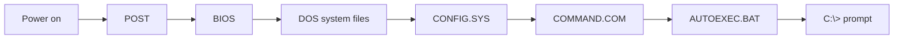

## How this note is ranked

Ranking is based on **your past-paper questions** (📌 = appeared in your set) and on what competitive exams usually ask. Nobody can promise the exact paper, so use the tiers like this:

|Tier|Meaning|What to do|
|---|---|---|
|⭐⭐⭐ **Must know**|appeared in your papers or is asked again and again|learn first, aim for 100%|
|⭐⭐ **Good to know**|likely, short facts|learn after Tier 1|
|⭐ **Skip for now**|history, versions, rare details|read only if everything else is done|

Your set had **19 DOS questions**. Every one of them is covered in Tier 1. The command **TREE** alone was asked **3 times** (Q115, Q410, Q519).

---

# ⭐⭐⭐ Tier 1: Must know

## 1. Commands asked in your papers

|Command|What it does|Asked|
|---|---|---|
|**TREE**|shows the **sub-directory structure** of a drive|📌 3 times|
|**TREE /F**|tree **plus files**|📌|
|**TYPE**|shows the **contents of a file**|📌|
|**DIR /B**|**bare**: names only, no size, date or time|📌|
|**DISKCOPY**|copies an **entire disk**|📌|
|**SYS**|copies **system files** to a disk (makes it bootable)|📌|
|**CHKDSK**|analyses and diagnoses disk errors, **reports status**|📌|
|**FORMAT**|divides a disk into **tracks and sectors**|📌|

Easy memory split: **COPY** = files. **DISKCOPY** = whole disk. **TREE** = folders. **TREE /F** = folders and files.

## 2. Internal vs external commands

|Internal (loaded at boot)|External (stay on disk)|
|---|---|
|COPY, DIR, TYPE, DEL|**EDIT**, **SYS**, **CHKDSK**|
|DATE, TIME, VER, VOL|FORMAT, DISKCOPY|
|PROMPT, CLS|XCOPY, TREE|

|Asked|Answer|
|---|---|
|Which commands are loaded into memory at boot? 📌|**internal** commands|
|Which group is external? 📌|**EDIT, SYS, CHKDSK**|

## 3. Boot and system facts

|Fact|Answer|Asked|
|---|---|---|
|Batch file read while booting|**AUTOEXEC.BAT**|📌|
|Key for Safe Mode|**F8**|📌|
|Key for BIOS setup|**F2** (also Del)|📌|
|FAT stands for|**File Allocation Table**|📌|
|Backup file extension|**.BAK**|📌|
|Maximum length of a DOS command|**127 characters**|📌|

## 4. Fragmentation and loader

|Topic|Answer|Asked|
|---|---|---|
|Fragmentation of the file system|can be **temporarily removed by compaction** (cannot be fully prevented)|📌 twice|
|Defragmentation|joins scattered pieces of files|📌|
|System program that puts a program into memory ready to run|**loader**|📌|
|Order|compile, link, **load**, run||

---

# ⭐⭐ Tier 2: Good to know

## 5. DOS basics

|Fact|Answer|
|---|---|
|Full form|**Disk Operating System** (MS-DOS = Microsoft DOS)|
|Interface|**CLI** (you type commands, no mouse)|
|Users and tasks|single-user, single-tasking|
|Prompt|`C:\>`|

## 6. File names and wildcards

|Item|Rule|
|---|---|
|File name|**8 characters + dot + 3-character extension** (8.3)|
|Case|not case sensitive|
|`*`|any number of characters|
|`?`|exactly one character|
|Example|`DEL *.BAK` deletes all backup files|

## 7. Everyday commands

|Command|Does|
|---|---|
|MD / MKDIR|make a directory|
|CD / CHDIR|change directory (`CD..` up one level, `CD\` root)|
|RD / RMDIR|remove an **empty** directory|
|COPY|copy files|
|DEL|delete files|
|REN|rename|
|XCOPY|copy files and folders|
|VER|show DOS version|
|CLS|clear screen|
|DATE / TIME|show or set date and time|
|PROMPT|change the prompt|

## 8. DIR switches

|Switch|Meaning|
|---|---|
|/W|wide list|
|/P|pause after each screen|
|/S|include sub-directories|
|/B|bare (names only, Tier 1)|

## 9. Boot files

|File|Job|
|---|---|
|**COMMAND.COM**|command interpreter, holds the internal commands|
|**CONFIG.SYS**|loads drivers and settings|
|**AUTOEXEC.BAT**|runs automatically at start-up (Tier 1)|

## 10. Batch files and redirection

|Item|Fact|
|---|---|
|Batch file|text file with **.BAT** extension that runs many commands in order|
|`>`|send output to a file (overwrite)|
|`>>`|send output to a file (append)|
|`<`|take input from a file|
|Pipe (vertical bar)|output of one command becomes input of the next|

---

# ⭐ Tier 3: Skip for now

Only read these if Tier 1 and Tier 2 are done. They are history and rare details.

|Detail|Value|
|---|---|
|Maker and year|Microsoft, 1981 (IBM version = PC-DOS)|
|Last standalone version|MS-DOS 6.22 (1994)|
|Hidden system files|IO.SYS, MSDOS.SYS|
|Conventional memory|640 KB (00000 to 9FFFF hex)|
|Upper memory|640 KB to 1 MB|
|File attributes|R read-only, A archive, S system, H hidden|
|Run order without extension|.COM, then .EXE, then .BAT|
|DOS 6 commands|DELTREE, SCANDISK, UNDELETE, MOVE|
|Other disk commands|FDISK (partitions), LABEL|
|Filters|MORE, SORT, FIND|
|Batch commands|ECHO, REM, PAUSE, GOTO, IF, FOR, CALL|
|Drives|A: and B: floppy, C: first hard disk|

---

# Questions and answers (ranked)

Level is shown before the answer. Cover the Answer column, answer in your head, then check.

## ⭐⭐⭐ Tier 1 questions

|#|Level|Question|Answer|
|---|---|---|---|
|1|🟢 Easy|Which command shows the sub-directory structure of a drive? (Q115, Q410, Q519) 📌|**TREE**|
|2|🟢 Easy|Which DOS command shows the contents of a file? (Q116) 📌|**TYPE**|
|3|🟡 Medium|Which command shows only file and directory names, no size, date or time? (Q117) 📌|**DIR /B**|
|4|🟡 Medium|Which command shows the directory list including files in tree structure? (Q417) 📌|**TREE /F**|
|5|🟢 Easy|Which command duplicates an entire disk? (Q518) 📌|**DISKCOPY**|
|6|🟡 Medium|What does the SYS command do? (Q515) 📌|copies system files to a disk|
|7|🟡 Medium|What does CHKDSK do? (Q411) 📌|analyses errors, diagnoses errors, reports status (all of these)|
|8|🟢 Easy|What is formatting? (Q660) 📌|dividing the disk into tracks and sectors|
|9|🟡 Medium|Which commands are loaded into main memory at boot? (Q122) 📌|internal commands|
|10|🔴 Hard|Which group has only external commands? (Q415) 📌|**EDIT, SYS, CHKDSK**|
|11|🟡 Medium|Which batch file is read while booting? (Q513) 📌|**AUTOEXEC.BAT**|
|12|🟢 Easy|Which extension suggests a backup copy? (Q520) 📌|**.BAK**|
|13|🟢 Easy|Which key enters Safe Mode during reboot? (Q406) 📌|**F8**|
|14|🟡 Medium|Which key enters the BIOS setup menu? (Q630) 📌|**F2**|
|15|🟢 Easy|What does FAT stand for? (Q407) 📌|**File Allocation Table**|
|16|🔴 Hard|What is the maximum length of a DOS command? (Q416) 📌|**127 characters**|
|17|🟡 Medium|Fragmentation of the file system: which is true? (Q123, Q413) 📌|can be temporarily removed by compaction|
|18|🟡 Medium|Which system program sets up an executable program in memory ready to run? (Q121) 📌|the **loader**|
|19|🔴 Hard|What does disk defragmentation mean? (Q635) 📌 ⚠️|joins scattered file pieces (the question is badly worded, see [[12 Doubtful Keys]])|

## ⭐⭐ Tier 2 questions

|#|Level|Question|Answer|
|---|---|---|---|
|20|🟢 Easy|Full form of DOS?|Disk Operating System|
|21|🟢 Easy|What type of interface does DOS have?|CLI (command line)|
|22|🟢 Easy|How many characters can a DOS file name have?|8, plus a dot and a 3-character extension|
|23|🟢 Easy|Which command makes a directory?|MD (MKDIR)|
|24|🟢 Easy|Which command removes an empty directory?|RD (RMDIR)|
|25|🟢 Easy|Which command shows the DOS version?|VER|
|26|🟢 Easy|Which command clears the screen?|CLS|
|27|🟡 Medium|Which file is the DOS command interpreter?|COMMAND.COM|
|28|🟡 Medium|Which file loads drivers and settings at boot?|CONFIG.SYS|
|29|🟡 Medium|What does `DEL *.BAK` do?|deletes all files with the .BAK extension|
|30|🟡 Medium|What does the wildcard `?` stand for?|exactly one character|
|31|🟡 Medium|Which symbol appends output to a file?|`>>` (a single `>` overwrites)|
|32|🟡 Medium|What is a batch file?|a .BAT text file that runs many commands in order|
|33|🟡 Medium|Which DIR switch gives a wide list?|/W|

## ⭐ Tier 3 questions (skip for now)

|#|Level|Question|Answer|
|---|---|---|---|
|34|🔴 Hard|Which area is the 640 KB used by DOS programs?|conventional memory|
|35|🔴 Hard|Name the four DOS file attributes.|R, A, S, H|
|36|🔴 Hard|In what order does DOS run a name typed with no extension?|.COM, .EXE, .BAT|
|37|🔴 Hard|Which hidden system files start DOS?|IO.SYS and MSDOS.SYS|
|38|🔴 Hard|Which DOS 6 command deletes a folder with everything inside?|DELTREE|
|39|🔴 Hard|Which command creates hard disk partitions?|FDISK|

> [!warning] Exam Trap ⚠️
> 
> - Only **internal** commands are loaded at boot.
> - COPY = files. **DISKCOPY** = whole disk.
> - TREE = folders. **TREE /F** = folders and files.
> - **DIR /B** = names only. DIR /W = wide.
> - Safe Mode = **F8**. BIOS = **F2**.
> - Fragmentation is removed only **temporarily**.

## Self-check

- [ ] Tier 1: __ / 19 (aim 19)
- [ ] Tier 2: __ / 14 (aim 12+)
- [ ] Log weak ones in [[15 Progress Tracker]]