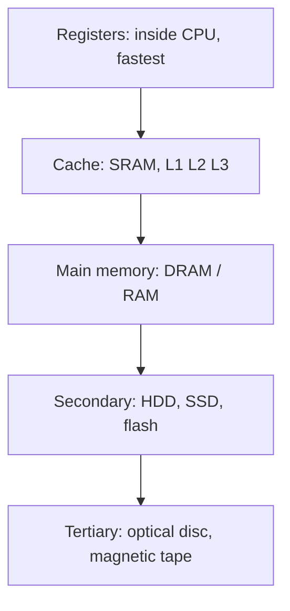

[[00 Computer Vault Index]]

# Memory, Storage & Devices

#computer #hw

**Part 1: learn the topic** (tables). **Part 2: past questions** (25: 🟢 16 · 🟡 8 · 🔴 1). Read Part 1 first, then test yourself in Part 2.

# Part 1: Learn the topic

## 1. Memory hierarchy

Going down: speed falls, size grows, cost per bit falls.

| Level       | Example             | Volatile? |
| ----------- | ------------------- | --------- |
| Register    | accumulator         | yes       |
| Cache       | L1, L2, L3          | yes       |
| Main memory | RAM                 | yes       |
| Secondary   | HDD, SSD, pen drive | no        |
| Tertiary    | tape, CD, DVD       | no        |

Cheapest per bit = **magnetic tape**. Fastest = **registers**.

## 2. RAM and ROM

| Feature     | RAM                           | ROM                |
| ----------- | ----------------------------- | ------------------ |
| Full form   | Random Access Memory          | Read Only Memory   |
| Volatile    | yes (loses data at power off) | no                 |
| Use         | running programs and data     | BIOS, boot program |
| Access time | equal for every location      | fixed              |

| RAM type    | Key facts                                                                                              |
| ----------- | ------------------------------------------------------------------------------------------------------ |
| SRAM        | fast, no refresh, costly, low density. Used in **cache**                                               |
| DRAM        | 1 transistor + 1 capacitor, **needs refresh**, cheap, high density, low power. Used as **main memory** |
| SDRAM / DDR | synchronous DRAM, in modern PCs                                                                        |

| ROM type   | Programmed by  | Erase                 |
| ---------- | -------------- | --------------------- |
| ROM (mask) | factory        | never                 |
| PROM       | user, **once** | never                 |
| EPROM      | user           | **UV light**          |
| EEPROM     | user           | **electrical** signal |
| Flash      | user           | electrical, in blocks |

- **CMOS** = battery-backed chip storing BIOS settings, date and time.
- **BIOS** = Basic Input Output System, first program at start-up (stored in ROM/flash).

## 3. Cache memory

| Term | Meaning |
|---|---|
| Locality of reference | programs reuse recent (temporal) and nearby (spatial) data. Basis of cache |
| 90-10 rule | 90% of time is spent in 10% of the code |
| Hit | data found in cache |
| Miss | data not in cache, fetched from RAM |
| Hit ratio | hits divided by total accesses. **Measure of cache performance** |

| Mapping | Idea |
|---|---|
| Direct | each block has exactly one cache line |
| Associative | a block can go in any line. Each line stores **address + data** |
| Set-associative | block can go in any line of one set |

Worked cache-width example: see [[09 Number Systems & Math Corner]].

## 4. Secondary storage

| Device | Technology | Key fact |
|---|---|---|
| HDD | magnetic | tracks are **concentric circles**, split into sectors |
| SSD | flash (NAND) | no moving parts, fast |
| Pen drive / memory card | **NAND flash** | cheap, high density |
| CD | optical, laser | about 700 MB, **single spiral track** |
| DVD | optical, laser | 4.7 GB (single layer) |
| Blu-ray | optical, blue laser | 25 GB (single layer) |
| Magnetic tape | magnetic | sequential access, backup, cheapest per bit |

| Flash type | Used for |
|---|---|
| NAND | storage: pen drive, SSD, SD card |
| NOR | code storage: firmware, boot code |

Magnetic disk structure: **platter**, **track** (ring), **sector** (slice of a track), **cylinder** (same track on all platters), **head** (reads and writes).

## 5. Input, output and recognition devices

| Input | Output | Both |
|---|---|---|
| keyboard, mouse, scanner | monitor, printer, plotter | touchscreen, modem |
| light pen, joystick, trackball | speaker, projector | |
| microphone, webcam, barcode reader | | |

| Recognition device | Reads | Typical use |
|---|---|---|
| OMR | marks / bubbles | objective answer sheets |
| OCR | printed characters | digitising text |
| MICR | magnetic ink characters | bank cheques |
| Barcode reader | bar patterns | shops |
| Biometric | fingerprint, iris, face | security access |

| Printer | Type | Notes |
|---|---|---|
| Dot matrix | impact | multipart forms |
| Daisy wheel | impact | letter quality, slow |
| Line printer | impact | whole line at once |
| Inkjet | non-impact | liquid ink |
| Laser | non-impact | **dry toner powder**, fast |
| Thermal | non-impact | heat on special paper, receipts |

## 6. Other device facts

| Topic | Fact |
|---|---|
| Pixel colour | each pixel = **3** dots: red, green, blue |
| Thumbnail | reduced-size preview of an image |
| Buffer | temporary storage that evens out speed difference between devices |
| Speech synthesizer | converts text to spoken words |
| Handheld computers | PDA (older), smartphone (modern) |
| IC chips | made of **silicon** |
| Audio bit depth | CD audio **16-bit**. DVD-Audio **16, 20, 24-bit** (24 is max) |

# Part 2: Past questions with answers

Answer in your head first, then open the callout. Level is shown before the answer. 🔁 = repeated in your paper. ⚠️ = doubtful key ([[12 Doubtful Keys]]).

### Q102 · 🟢 Easy
**Q.** The idea of cache memory is based ____

> [!success]- Answer
> **all of the above**
> All three say the same thing: programs reuse nearby and recent data. If two or more options are true, pick 'all of the above'.
> Don't confuse with: on locality of reference; on the 90-10 rule; on the fact that references tend to cluster

### Q165 · 🟢 Easy
**Q.** Which memory has equal time to access any location?

> [!success]- Answer
> **RAM**
> RAM = Random Access Memory: any location, same time.
> Don't confuse with: ROM; PROM; EPROM

### Q168 · 🟢 Easy
**Q.** Commonly used Pen Drive nowadays uses ____

> [!success]- Answer
> **NAND flash**
> NAND flash = pen drives, SSDs, memory cards (cheap, dense, block access). NOR flash = firmware/code storage.
> Don't confuse with: OR flash; NOR flash; AND flash

### Q232 · 🟢 Easy
**Q.** Mainly used for checking objective-type answer papers ____

> [!success]- Answer
> **OMR**
> OMR = Optical MARK Recognition (bubbles). OCR = characters, MICR = magnetic ink (bank cheques).
> Don't confuse with: MICR; OCR; All

### Q358 · 🟢 Easy
**Q.** Main memory of a computer is ____

> [!success]- Answer
> **Internal**
> Main memory (RAM) is internal/primary. Auxiliary = secondary storage (HDD etc.).
> Don't confuse with: External; Both; Auxiliary

### Q376 · Q486 🔁 · 🟢 Easy
**Q.** In magnetic disks, data is organised on the platter in concentric rings called ____

> [!success]- Answer
> **Track**
> Rings = tracks. Tracks are cut into sectors (pie slices).
> Don't confuse with: Sector; Head; Block

### Q387 · 🟢 Easy
**Q.** Printer using dry ink powder ____

> [!success]- Answer
> **Laser printer**
> Laser printers use toner (dry powder). Inkjet = liquid ink.
> Don't confuse with: Daisy wheel; Line printer; Thermal printer

### Q405 · 🟢 Easy
**Q.** Medium to convert text into spoken sentences ____

> [!success]- Answer
> **Speech Synthesizers**
> Text-to-speech = speech synthesizer.
> Don't confuse with: Speech Sensors; Compact convertors; Voice systems

### Q455 · 🟢 Easy
**Q.** Reduced size version of a digital image ____

> [!success]- Answer
> **Thumbnail**
> Thumbnail = small preview image.
> Don't confuse with: Token; Sample; Halftone

### Q494 · 🟢 Easy
**Q.** Optical storage can be defined as ____

> [!success]- Answer
> **laser used for retrieval**
> CD/DVD/Blu-ray: data read with a laser.
> Don't confuse with: optical cable used; electromagnetic; None

### Q498 · 🟢 Easy
**Q.** Memory that must be refreshed many times per second ____

> [!success]- Answer
> **Dynamic RAM**
> DRAM's capacitors leak, so they need refresh. Static RAM does not.
> Don't confuse with: EPROM; ROM; Static RAM

### Q553 · 🟢 Easy
**Q.** IC chips are usually made of ____

> [!success]- Answer
> **Silicon**
> Silicon (semiconductor). 'Silicon Valley'.
> Don't confuse with: Lead; Chromium; Gold

### Q571 · 🟢 Easy
**Q.** Device providing communication between computer and outer world ____

> [!success]- Answer
> **Input/Output**
> I/O devices connect the computer to the outside world.
> Don't confuse with: Compact Disc; Drivers; Magnetic storage

### Q572 · 🟢 Easy
**Q.** Each pixel on a screen is composed of how many colour dots ____

> [!success]- Answer
> **3**
> Red + Green + Blue = 3 sub-pixels (RGB).
> Don't confuse with: 24; 16; 8

### Q573 · 🟢 Easy
**Q.** Temporary storage to compensate for difference in data rate ____

> [!success]- Answer
> **Buffer**
> Buffer smooths speed mismatch (e.g., printer vs CPU, video streaming).
> Don't confuse with: Bus; Channel; Modem

### Q707 · 🟢 Easy
**Q.** Memory type that can be erased by light ____

> [!success]- Answer
> **EPROM**
> EPROM = Erasable by UV light. EEPROM = Electrically erasable.
> Don't confuse with: ROM; PROM; EEPROM

### Q83 · 🟡 Medium
**Q.** Samples/bit-depth in a DVD-audio digital sound system ____

> [!success]- Answer
> **24-bit**
> DVD-Audio supports 16, 20 and 24-bit. 24-bit is the maximum (CD audio is only 16-bit).
> Don't confuse with: 16-bit; 18-bit; 20-bit

### Q92 · 🟡 Medium
**Q.** Memory location addresses are limited to the range ____

> [!success]- Answer
> **00000 to 9FFFF(16)**
> Addresses start at 00000 (never 00001). 00000-9FFFF hex = 640 KB, the DOS-era conventional memory.
> Don't confuse with: 00001 to 9FFFF(16); 00010 to 9FFFF(16); 10000 to 9FFFF(16)

### Q169 · 🟡 Medium
**Q.** Track organisation in an optical disk ____

> [!success]- Answer
> **Spiral**
> CD/DVD has ONE spiral track. Magnetic disks (HDD) use concentric circles.
> Don't confuse with: Straight line; Parallel lines; Concentric circles

### Q377 · 🟡 Medium
**Q.** Performance of cache memory is measured by ____

> [!success]- Answer
> **hit ratio**
> Hit ratio = (hits / total accesses). Higher = better cache.
> Don't confuse with: miss ratio; latency ratio; read ratio

### Q485 · 🟡 Medium
**Q.** Non-volatile chip that stores date and configuration ____

> [!success]- Answer
> **CMOS**
> CMOS (battery-backed) stores BIOS settings, date and time.
> Don't confuse with: RAM; JFET; FET

### Q493 · 🟡 Medium
**Q.** ROM manufactured without initial storage is termed ____

> [!success]- Answer
> **PROM**
> PROM = blank chip the user programs ONCE. Plain ROM is programmed at the factory.
> Don't confuse with: EROM; BROM; DROM

### Q508 · 🟡 Medium
**Q.** Popular type of handheld computer ____

> [!success]- Answer
> **smart phone** ⚠️
> Smartphone is the modern answer (PDA is the older textbook answer). Older keys may say PDA.
> Don't confuse with: PDA; DSLR; Laptop

### Q805 · 🟡 Medium
**Q.** Lowest cost-per-bit storage ____

> [!success]- Answer
> **Magnetic Tape**
> Cost per bit rises as speed rises. Tape is cheapest and slowest (archival).
> Don't confuse with: Cache; SSD; RAM; Hard disk

### Q104 · 🔴 Hard
**Q.** Generally Dynamic RAM is used as main memory because it ____

> [!success]- Answer
> **consumes less power** ⚠️
> DRAM = 1 transistor + 1 capacitor per bit: dense, cheap, low power. Refreshing (d) is a drawback, 'lower density' (c) is false, and SRAM is faster (b). Keys differ on this one; (a) is the commonly accepted answer.
> Don't confuse with: has higher speed; has lower cell density; needs refreshing circuitry

> [!warning] Exam Trap ⚠️
> - Magnetic disk = **concentric tracks**. Optical disc = **one spiral**.
> - OMR (marks) vs OCR (characters) vs MICR (cheques).
> - 'Needs refresh' is a DRAM *drawback*, not a reason to choose it.
> - EPROM = UV light. EEPROM = electric.
> - Associative cache stores **address + data**.

## Self-check
- [ ] Round 1: __ / 25
- [ ] Round 2 (next day): __ / 25
- [ ] Round 3 (3 days later): __ / 25
- Close the topic at **85%**. Log it in [[15 Progress Tracker]].
