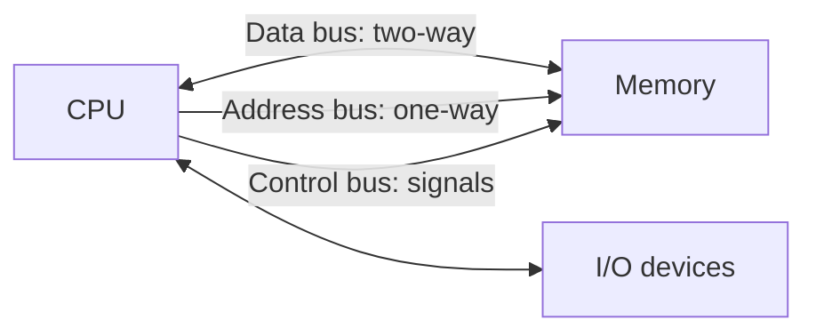

[[00 Computer Vault Index]]

# CPU, Registers & Buses

#computer #cpu

**Part 1: learn the topic** (tables). **Part 2: past questions** (16: 🟢 8 · 🟡 7 · 🔴 1). Read Part 1 first, then test yourself in Part 2.

# Part 1: Learn the topic

## 1. Parts of the CPU

| Part | Job |
|---|---|
| ALU | arithmetic and logic operations |
| Control Unit (CU) | fetches, **decodes**, controls everything |
| Registers | tiny, fastest memory inside the CPU |

Microprocessor = CPU on one chip. **Microcontroller** = CPU + small RAM/ROM + I/O on one chip.

## 2. Registers

| Register | Holds |
|---|---|
| Program Counter (PC) | address of the **next** instruction |
| Instruction Register (IR) | instruction being executed **now** |
| Accumulator (ACC) | results of ALU operations |
| Flag / Status register (PSW) | condition flags |
| MAR | memory address to access |
| MDR / MBR | data going to or from memory |
| Stack Pointer (SP) | top of the stack |

| Flag | Set when |
|---|---|
| Zero | result is 0 |
| Carry | carry out of top bit |
| Sign | result negative |
| Overflow | result too big for the register |

## 3. Buses

| Bus | Direction | Carries |
|---|---|---|
| Address | **one-way** (CPU to memory) | where to read or write |
| Data | **two-way** | the data |
| Control | both | read, write, clock signals |

Width: address bus width fixes **memory capacity**. Data bus width fixes **word size / speed**.

| System bus standard | Notes |
|---|---|
| ISA | oldest, slowest |
| VL bus | faster than ISA |
| PCI | faster than ISA and VL. Used for cards, video |
| AGP / PCIe | graphics, newer |
| SCSI | disks and devices |
| USB | external devices |

## 4. Instruction cycle

- Instruction format = **opcode** (what to do) + **operand** (data or address).
- **Instruction set** = all machine instructions a CPU understands.

| Instruction group | Examples |
|---|---|
| Data transfer | MOV, LOAD, STORE |
| Arithmetic | ADD, SUB |
| Logic | AND, OR, NOT |
| Branch / control | JMP, CALL, HALT |

## 5. Addressing capacity

| Processor | Data bus | Address bus | Memory |
|---|---|---|---|
| 8085 | 8 | 16 | 64 KB |
| 8086 | 16 | 20 | 1 MB |
| 80386 | 32 | 32 | 4 GB |

DOS-era **conventional memory** = first 640 KB = addresses 00000 to 9FFFF (hex).

## 6. Computer flow (IPO)

Input, Processing, Memory/Storage, Output. Word = fixed number of bits processed together (8, 16, 32, 64).

# Part 2: Past questions with answers

Answer in your head first, then open the callout. Level is shown before the answer. 🔁 = repeated in your paper. ⚠️ = doubtful key ([[12 Doubtful Keys]]).

### Q95 · Q381 🔁 · 🟢 Easy
**Q.** The address bus flows ____

> [!success]- Answer
> **Unidirection**
> Address bus is ONE-WAY: CPU to memory/I/O (CPU says where). Data bus is two-way. Hook: Address = Away.
> Don't confuse with: Bidirection; Multidirection; Circular

### Q96 · Q382 · Q495 🔁 · 🟢 Easy
**Q.** Status register is also called ____

> [!success]- Answer
> **Flags**
> Holds condition flags (zero, carry, sign, overflow). Also called Flag register / PSW.
> Don't confuse with: Accumulator; Stack; Counter

### Q106 · 🟢 Easy
**Q.** Communication between microcomputer components takes place via the address and ____

> [!success]- Answer
> **Data bus**
> Standard buses = address + data + control. 'Address' is already given and (c) repeats it, so the missing partner is Data bus.
> Don't confuse with: I/O bus; Address bus; Control lines

### Q161 · 🟢 Easy
**Q.** Fixed number of memory cells processed as a group ____

> [!success]- Answer
> **Word**
> Word = unit the CPU handles at once (word length: 8/16/32/64 bits).
> Don't confuse with: Group; Memory Set; Bump

### Q164 · Q391 🔁 · 🟢 Easy
**Q.** Register containing the address of the next instruction ____

> [!success]- Answer
> **Program counter**
> PC = address of NEXT instruction. IR = the instruction being executed now.
> Don't confuse with: Instruction register; Accumulator; Container

### Q489 · 🟢 Easy
**Q.** Built-in set of machine code instructions of a computer ____

> [!success]- Answer
> **instruction set**
> Instruction set = all machine instructions the CPU understands.
> Don't confuse with: transfer of data; logical operations; logical set

### Q497 · 🟢 Easy
**Q.** Contains processing unit and a small amount of memory ____

> [!success]- Answer
> **Microcontroller**
> Microcontroller = CPU + small RAM/ROM + I/O on one chip. Microprocessor = CPU only.
> Don't confuse with: Microprocessor; Nanometer; Unicontroller

### Q902 · 🟢 Easy
**Q.** ______ unit sends the processed results to the user ____

> [!success]- Answer
> **Output**
> Output unit.
> Don't confuse with: Input; Memory; Control

### Q483 · 🟡 Medium
**Q.** Output of ALU operations is stored in ____

> [!success]- Answer
> **Registers**
> ALU results go to a register (usually the accumulator). Flags only record status.
> Don't confuse with: Memory Devices; Flags; Output Unit

### Q484 · 🟡 Medium
**Q.** Data is distributed through the system in the order ____

> [!success]- Answer
> **Input, Processing, Memory, Storage, Output**
> The IPO cycle with storage: Input, Processing, Memory, Storage, Output.
> Don't confuse with: Output-Input; Memory-Processing; Both a & b

### Q487 · 🟡 Medium
**Q.** Common bus specification with the fastest data transfer rate ____

> [!success]- Answer
> **PCI**
> PCI is fastest of the three. ISA is the oldest and slowest.
> Don't confuse with: VL bus; ISA; All of these

### Q488 · 🟡 Medium
**Q.** Bus used to connect the monitor to the CPU ____

> [!success]- Answer
> **PCI bus**
> Graphics cards sat on PCI (later AGP/PCIe). SCSI = disks, Rambus = RAM.
> Don't confuse with: SCSI bus; Memory bus; Rambus

### Q504 · 🟡 Medium
**Q.** A machine language instruction format consists of ____

> [!success]- Answer
> **Operation code and operand**
> Opcode (what to do) + operand (what to do it on).
> Don't confuse with: Operand; Operation code; None

### Q554 · 🟡 Medium
**Q.** Control unit's function in the CPU ____

> [!success]- Answer
> **decode instructions**
> CU fetches and decodes instructions and directs other parts. ALU does logic.
> Don't confuse with: transfer data; store instructions; perform logic functions

### Q777 · 🟡 Medium
**Q.** Internal memory in a processor consists of ____

> [!success]- Answer
> **set of registers**
> CPU's internal memory = registers.
> Don't confuse with: ALUs; microprocessor; data bus

### Q491 · 🔴 Hard
**Q.** Which category of microprocessor instructions detect status conditions?

> [!success]- Answer
> **Operation** ⚠️
> Arithmetic/logic 'operation' instructions set the status flags. Doubtful question; verify against your key.
> Don't confuse with: Transfer; Control Instructions; All of these

> [!warning] Exam Trap ⚠️
> - PC = *next* instruction. IR = *current* instruction.
> - Status register = **Flags** (not Accumulator).
> - Address bus is **one-way**. Data bus is **two-way**.
> - ALU computes. **Control unit decodes**.
> - Memory capacity depends on the **address** bus, not the data bus.

## Self-check
- [ ] Round 1: __ / 16
- [ ] Round 2 (next day): __ / 16
- [ ] Round 3 (3 days later): __ / 16
- Close the topic at **85%**. Log it in [[15 Progress Tracker]].
