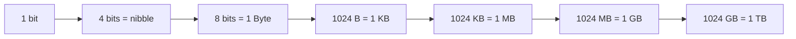
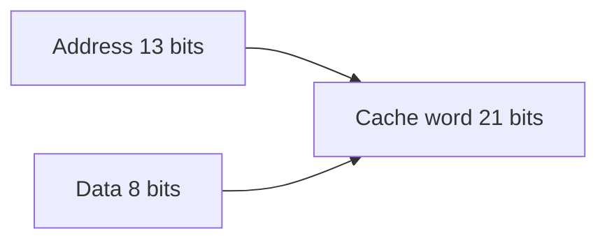

[[00 Computer Vault Index]]

# Number Systems & Math Corner

#computer #math

**Part 1: learn the topic** (tables). **Part 2: past questions** (8: 🟢 5 · 🟡 1 · 🔴 2). Read Part 1 first, then test yourself in Part 2.

# Part 1: Learn the topic

## 1. Number systems

| System | Base | Digits |
|---|---|---|
| Binary | 2 | 0, 1 |
| Octal | 8 | 0-7 |
| Decimal | 10 | 0-9 |
| Hexadecimal | 16 | 0-9, A-F |

Binary 1011 = 8 + 2 + 1 = **11**. Decimal 13 = 8 + 4 + 1 = **1101**. Hex B = 11, F = 15.

## 2. Data units

| Fact | Answer |
|---|---|
| Bit | **Bi**nary Digi**t**, smallest unit |
| 8 binary digits | 1 byte |
| One keystroke | 1 byte |
| 12 GB in bytes | 12 x 1024 x 1024 x 1024 = 12,884,901,888 |

## 3. Symbols and codes

| Code | Bits | Symbols |
|---|---|---|
| ASCII | 7 | 128 |
| Extended ASCII | 8 | **256** |
| Unicode | 16+ | all languages |

Rule: **n bits give 2^n symbols**.

## 4. Address lines rule

n address lines reach **2^n locations**.

| Address lines | Locations |
|---|---|
| 10 | 1 K (1024) |
| 13 | 8 K |
| 16 | 64 K |
| 20 | 1 MB |
| 32 | **4 GB** |

**Q167 example:** 1K x 1 memory, so 1K = 1024 = 2^10, so **10 address lines**. (The x1 means 1 bit per location.)

**Q107 example:** 16-bit data bus, 32-bit address bus. Capacity depends on address bus only: 2^32 = **4 GB**.

## 5. Cache word width (associative mapping)

Q105: main memory 8K bytes, cache 2K words, associative mapping.

1. Address bits: 8K = 2^13, so **13 bits**
2. Data bits: 1 byte = **8 bits**
3. Associative mapping stores address + data in each cache word
4. 13 + 8 = **21 bits**

# Part 2: Past questions with answers

Answer in your head first, then open the callout. Level is shown before the answer. 🔁 = repeated in your paper. ⚠️ = doubtful key ([[12 Doubtful Keys]]).

### Q167 · 🟢 Easy
**Q.** 1Kb (1024 bit) memory organised as 1Kx1: number of address lines needed ____

> [!success]- Answer
> **10**
> 1K = 1024 = 2^10 locations, so 10 address lines. (x1 means 1 bit per location.)
> Don't confuse with: 6; 14; 18

### Q473 · 🟢 Easy
**Q.** A bit stands for ____

> [!success]- Answer
> **Binary Digit**
> BInary digiT.
> Don't confuse with: Binary Data; Binary Deci; Binary Code

### Q614 · 🟢 Easy
**Q.** Unit of data eight binary digits long ____

> [!success]- Answer
> **Bytes**
> 8 bits = 1 byte.
> Don't confuse with: Bits; Kilobytes; Megabytes

### Q804 · 🟢 Easy
**Q.** 8-bit binary can represent how many symbols ____

> [!success]- Answer
> **256**
> 2^8 = 256.
> Don't confuse with: 128; 512; 1024

### Q837 · 🟢 Easy
**Q.** One keystroke generates 1 ___ of data ____

> [!success]- Answer
> **Byte**
> 1 character = 1 byte (ASCII).
> Don't confuse with: Bit; Kilobyte; Gigabyte

### Q107 · 🟡 Medium
**Q.** Maximum addressing capacity of a microprocessor with 16-bit data bus and 32-bit address bus ____

> [!success]- Answer
> **4 GB**
> Capacity depends on the ADDRESS bus only: 2^32 = 4 GB. The 16-bit data bus is a distraction (64K would be 16 address bits).
> Don't confuse with: 64 K; both a & b; None

### Q105 · 🔴 Hard
**Q.** Main memory is 8K bytes, cache is 2K words, associative mapping. Each word of cache shall be ____

> [!success]- Answer
> **21 bits**
> See Math Corner. Address = 13 bits (8K = 2^13), data = 8 bits (byte). Associative mapping stores full address + data in each cache word: 13 + 8 = 21.
> Don't confuse with: 11 bits; 16 bits; 20 bits

### Q694 · 🔴 Hard
**Q.** Bytes equivalent to 12 GB ____  
(choose from: a) 1024; b) 12 x 1024; c) 1024 x 1024 x 1024; d) 1024)

> [!success]- Answer
> **12 x 1024** ⚠️
> Correct maths = 12 x 1024 x 1024 x 1024 = 12,884,901,888 bytes, which is not listed. (b) is the closest/usual key.

> [!warning] Exam Trap ⚠️
> - Address bus width sets capacity. Data bus width does not.
> - 1K x 1 = **1024 locations**, so 10 lines.
> - Associative cache word = address + data.

## Self-check
- [ ] Round 1: __ / 8
- [ ] Round 2 (next day): __ / 8
- [ ] Round 3 (3 days later): __ / 8
- Close the topic at **85%**. Log it in [[15 Progress Tracker]].
