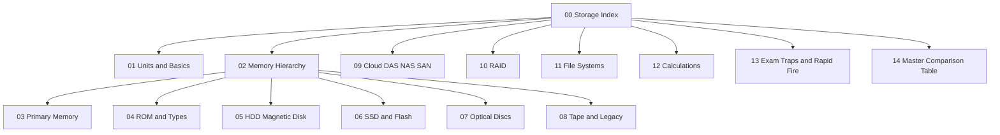

# 💾 Computer Storage — Master Index

> [!abstract] One-line idea
> Every storage device trades **speed ↔ capacity ↔ cost ↔ volatility**. Faster = smaller + costlier + (usually) volatile. Slower = bigger + cheaper + permanent.

## 🗺️ Vault map

## 📚 Study order
| # | Note | Priority | Why |
|---|------|----------|-----|
| 1 | [[01 Units and Basics]] | ⭐⭐⭐ | Foundation, every calculation uses it |
| 2 | [[02 Memory Hierarchy]] | ⭐⭐⭐ | Classic exam question: order by speed/cost |
| 3 | [[03 Primary Memory]] | ⭐⭐⭐ | RAM, SRAM vs DRAM, Cache, Registers |
| 4 | [[04 ROM and Types]] | ⭐⭐⭐ | ROM/PROM/EPROM/EEPROM/Flash = favourite |
| 5 | [[05 HDD Magnetic Disk]] | ⭐⭐⭐ | Tracks, sectors, platters |
| 6 | [[06 SSD and Flash]] | ⭐⭐ | Pen drive, SD card, NVMe |
| 7 | [[07 Optical Discs]] | ⭐⭐⭐ | CD/DVD/Blu-ray capacities |
| 8 | [[08 Tape and Legacy]] | ⭐⭐ | Sequential access, floppy sizes |
| 9 | [[09 Cloud DAS NAS SAN]] | ⭐⭐ | Modern awareness |
| 10 | [[10 RAID]] | ⭐⭐ | Levels and min disks |
| 11 | [[11 File Systems]] | ⭐⭐ | FAT32/NTFS/ext4 |
| 12 | [[12 Calculations]] | ⭐⭐⭐ | Arithmetic marks live here |
| 13 | [[13 Exam Traps and Rapid Fire]] | ⭐⭐⭐ | Final revision, cold-test yourself |
| 14 | [[14 Master Comparison Table]] | ⭐⭐⭐ | One-page summary |

> [!note] Priority is my judgment from typical exam patterns, not your frequency data
> Re-rank these files against your own 527 Computer Knowledge questions. Close each file at 85% accuracy, then move on.

## 🔁 How to use (active recall)
1. Read a note **once**.
2. Cover the answers. Q&A tables hide answers with `||spoiler||` (needs a spoiler plugin, or just cover with your hand).
3. Calculation notes show **difficulty before the solution**. Attempt first, then expand the callout.
4. Finish with [[13 Exam Traps and Rapid Fire]] before sleep.
