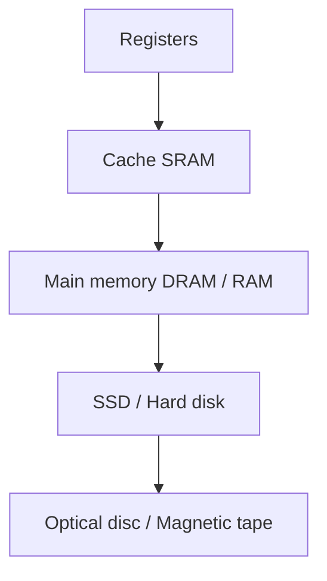

[[00 Computer Vault Index]]

# Memory & Storage Devices

#computer #hw

**25 questions** · 🟢 16 · 🟡 8 · 🔴 1

## Concept core

**Memory hierarchy** (top = faster, smaller, costlier per bit)

| Type | Key fact | Exam hook |
|---|---|---|
| SRAM | fast, no refresh, costly | cache |
| DRAM | 1 transistor + 1 capacitor, needs **refresh**, dense, cheap | main memory |
| ROM | programmed at factory | BIOS |
| PROM | programmed **once** by user | blank chip |
| EPROM | erase with **UV light** | E = Erasable |
| EEPROM | erase **electrically** | |
| Flash | EEPROM in blocks. **NAND** = pen drive/SSD, **NOR** = firmware | |

- Magnetic disk: **concentric tracks** split into sectors. Optical disc: **one spiral** track.
- Input devices that read marks: **OMR** (bubbles/answer sheets), **OCR** (printed characters), **MICR** (magnetic ink, bank cheques).
- Laser printer = dry toner powder. Cache performance = **hit ratio**.

## Q&A: answer first, then open the Answer callout

Ordered easy to hard. Level is shown **before** the answer. 🔁 = repeated in your paper. ⚠️ = doubtful key, see [[12 Doubtful Keys]].

### Q102 · 🟢 Easy
The idea of cache memory is based:  
a) on locality of reference  
b) on the 90-10 rule  
c) on the fact that references tend to cluster  
d) all of the above

> [!success]- Answer
> **d) all of the above**
> All three say the same thing: programs reuse nearby and recent data. If two or more options are true, pick 'all of the above'.

### Q165 · 🟢 Easy
Which memory has equal time to access any location:  
a) RAM  
b) ROM  
c) PROM  
d) EPROM

> [!success]- Answer
> **a) RAM**
> RAM = Random Access Memory: any location, same time.

### Q168 · 🟢 Easy
Commonly used Pen Drive nowadays uses:  
a) OR flash  
b) NOR flash  
c) NAND flash  
d) AND flash

> [!success]- Answer
> **c) NAND flash**
> NAND flash = pen drives, SSDs, memory cards (cheap, dense, block access). NOR flash = firmware/code storage.

### Q232 · 🟢 Easy
Mainly used for checking objective-type answer papers:  
a) MICR  
b) OMR  
c) OCR  
d) All

> [!success]- Answer
> **b) OMR**
> OMR = Optical MARK Recognition (bubbles). OCR = characters, MICR = magnetic ink (bank cheques).

### Q358 · 🟢 Easy
Main memory of a computer is:  
a) Internal  
b) External  
c) Both  
d) Auxiliary

> [!success]- Answer
> **a) Internal**
> Main memory (RAM) is internal/primary. Auxiliary = secondary storage (HDD etc.).

### Q376 · Q486 🔁 · 🟢 Easy
In magnetic disks, data is organised on the platter in concentric rings called:  
a) Sector  
b) Track  
c) Head  
d) Block

> [!success]- Answer
> **b) Track**
> Rings = tracks. Tracks are cut into sectors (pie slices).

### Q387 · 🟢 Easy
Printer using dry ink powder:  
a) Daisy wheel  
b) Line printer  
c) Laser printer  
d) Thermal printer

> [!success]- Answer
> **c) Laser printer**
> Laser printers use toner (dry powder). Inkjet = liquid ink.

### Q405 · 🟢 Easy
Medium to convert text into spoken sentences:  
a) Speech Sensors  
b) Compact convertors  
c) Speech Synthesizers  
d) Voice systems

> [!success]- Answer
> **c) Speech Synthesizers**
> Text-to-speech = speech synthesizer.

### Q455 · 🟢 Easy
Reduced size version of a digital image:  
a) Token  
b) Thumbnail  
c) Sample  
d) Halftone

> [!success]- Answer
> **b) Thumbnail**
> Thumbnail = small preview image.

### Q494 · 🟢 Easy
Optical storage can be defined as:  
a) laser used for retrieval  
b) optical cable used  
c) electromagnetic  
d) None

> [!success]- Answer
> **a) laser used for retrieval**
> CD/DVD/Blu-ray: data read with a laser.

### Q498 · 🟢 Easy
Memory that must be refreshed many times per second:  
a) EPROM  
b) ROM  
c) Static RAM  
d) Dynamic RAM

> [!success]- Answer
> **d) Dynamic RAM**
> DRAM's capacitors leak, so they need refresh. Static RAM does not.

### Q553 · 🟢 Easy
IC chips are usually made of:  
a) Lead  
b) Silicon  
c) Chromium  
d) Gold

> [!success]- Answer
> **b) Silicon**
> Silicon (semiconductor). 'Silicon Valley'.

### Q571 · 🟢 Easy
Device providing communication between computer and outer world:  
a) Compact Disc  
b) Input/Output  
c) Drivers  
d) Magnetic storage

> [!success]- Answer
> **b) Input/Output**
> I/O devices connect the computer to the outside world.

### Q572 · 🟢 Easy
Each pixel on a screen is composed of how many colour dots:  
a) 24  
b) 16  
c) 8  
d) 3

> [!success]- Answer
> **d) 3**
> Red + Green + Blue = 3 sub-pixels (RGB).

### Q573 · 🟢 Easy
Temporary storage to compensate for difference in data rate:  
a) Buffer  
b) Bus  
c) Channel  
d) Modem

> [!success]- Answer
> **a) Buffer**
> Buffer smooths speed mismatch (e.g., printer vs CPU, video streaming).

### Q707 · 🟢 Easy
Memory type that can be erased by light:  
a) ROM  
b) PROM  
c) EPROM  
d) EEPROM

> [!success]- Answer
> **c) EPROM**
> EPROM = Erasable by UV light. EEPROM = Electrically erasable.

### Q83 · 🟡 Medium
Samples/bit-depth in a DVD-audio digital sound system:  
a) 16-bit  
b) 18-bit  
c) 20-bit  
d) 24-bit

> [!success]- Answer
> **d) 24-bit**
> DVD-Audio supports 16, 20 and 24-bit. 24-bit is the maximum (CD audio is only 16-bit).

### Q92 · 🟡 Medium
Memory location addresses are limited to the range:  
a) 00000 to 9FFFF(16)  
b) 00001 to 9FFFF(16)  
c) 00010 to 9FFFF(16)  
d) 10000 to 9FFFF(16)

> [!success]- Answer
> **a) 00000 to 9FFFF(16)**
> Addresses start at 00000 (never 00001). 00000-9FFFF hex = 640 KB, the DOS-era conventional memory.

### Q169 · 🟡 Medium
Track organisation in an optical disk:  
a) Straight line  
b) Parallel lines  
c) Concentric circles  
d) Spiral

> [!success]- Answer
> **d) Spiral**
> CD/DVD has ONE spiral track. Magnetic disks (HDD) use concentric circles.

### Q377 · 🟡 Medium
Performance of cache memory is measured by:  
a) miss ratio  
b) hit ratio  
c) latency ratio  
d) read ratio

> [!success]- Answer
> **b) hit ratio**
> Hit ratio = (hits / total accesses). Higher = better cache.

### Q485 · 🟡 Medium
Non-volatile chip that stores date and configuration:  
a) RAM  
b) CMOS  
c) JFET  
d) FET

> [!success]- Answer
> **b) CMOS**
> CMOS (battery-backed) stores BIOS settings, date and time.

### Q493 · 🟡 Medium
ROM manufactured without initial storage is termed:  
a) PROM  
b) EROM  
c) BROM  
d) DROM

> [!success]- Answer
> **a) PROM**
> PROM = blank chip the user programs ONCE. Plain ROM is programmed at the factory.

### Q508 · 🟡 Medium
Popular type of handheld computer:  
a) smart phone  
b) PDA  
c) DSLR  
d) Laptop

> [!success]- Answer
> **a) smart phone** ⚠️
> Smartphone is the modern answer (PDA is the older textbook answer). Older keys may say PDA.

### Q805 · 🟡 Medium
Lowest cost-per-bit storage:  
a) Cache  
b) SSD  
c) RAM  
d) Hard disk  
e) Magnetic Tape

> [!success]- Answer
> **e) Magnetic Tape**
> Cost per bit rises as speed rises. Tape is cheapest and slowest (archival).

### Q104 · 🔴 Hard
Generally Dynamic RAM is used as main memory because it:  
a) consumes less power  
b) has higher speed  
c) has lower cell density  
d) needs refreshing circuitry

> [!success]- Answer
> **a) consumes less power** ⚠️
> DRAM = 1 transistor + 1 capacitor per bit: dense, cheap, low power. Refreshing (d) is a drawback, 'lower density' (c) is false, and SRAM is faster (b). Keys differ on this one; (a) is the commonly accepted answer.

> [!warning] Exam Trap ⚠️
> - Magnetic disk = **concentric circles**; optical disc = **spiral**. They love swapping these.
> - OMR (marks) vs OCR (characters) vs MICR (cheques).
> - 'Needs refreshing' is a DRAM *drawback*, not its advantage.
> - EPROM = UV light; EEPROM = electric.

## Self-check
- [ ] Round 1 score: __ / 25
- [ ] Round 2 (next day): __ / 25
- [ ] Round 3 (after 3 days): __ / 25
- Close topic at **85%**. Log in [[15 Progress Tracker]].
