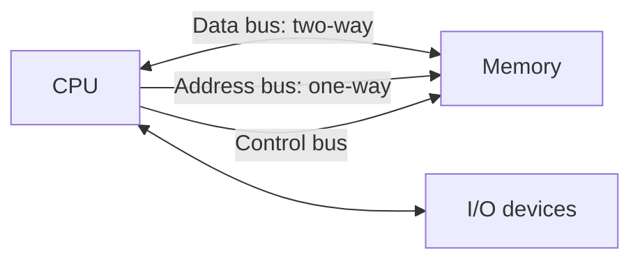

[[00 Computer Vault Index]]

# CPU, Registers & Buses

#computer #cpu

**16 questions** · 🟢 8 · 🟡 7 · 🔴 1

## Concept core

CPU = **ALU** (arithmetic/logic) + **CU** (fetch, decode, control) + **Registers** (tiny fast memory inside CPU).

| Register | Holds |
|---|---|
| Program Counter (PC) | address of the **next** instruction |
| Instruction Register (IR) | instruction being executed **now** |
| Accumulator | ALU results |
| Flag / Status register (PSW) | zero, carry, sign, overflow flags |
| MAR / MDR | memory address / data being transferred |

- **Address bus: one-way** (CPU says where). **Data bus: two-way**.
- Instruction = **opcode** (what) + **operand** (on what).
- Cycle: Fetch, Decode, Execute.
- Microprocessor = CPU only. Microcontroller = CPU + RAM/ROM + I/O on one chip.

## Q&A: answer first, then open the Answer callout

Ordered easy to hard. Level is shown **before** the answer. 🔁 = repeated in your paper. ⚠️ = doubtful key, see [[12 Doubtful Keys]].

### Q95 · Q381 🔁 · 🟢 Easy
The address bus flows:  
a) Bidirection  
b) Unidirection  
c) Multidirection  
d) Circular

> [!success]- Answer
> **b) Unidirection**
> Address bus is ONE-WAY: CPU to memory/I/O (CPU says where). Data bus is two-way. Hook: Address = Away.

### Q96 · Q382 · Q495 🔁 · 🟢 Easy
Status register is also called:  
a) Accumulator  
b) Stack  
c) Counter  
d) Flags

> [!success]- Answer
> **d) Flags**
> Holds condition flags (zero, carry, sign, overflow). Also called Flag register / PSW.

### Q106 · 🟢 Easy
Communication between microcomputer components takes place via the address and:  
a) I/O bus  
b) Data bus  
c) Address bus  
d) Control lines

> [!success]- Answer
> **b) Data bus**
> Standard buses = address + data + control. 'Address' is already given and (c) repeats it, so the missing partner is Data bus.

### Q161 · 🟢 Easy
Fixed number of memory cells processed as a group:  
a) Group  
b) Memory Set  
c) Bump  
d) Word

> [!success]- Answer
> **d) Word**
> Word = unit the CPU handles at once (word length: 8/16/32/64 bits).

### Q164 · Q391 🔁 · 🟢 Easy
Register containing the address of the next instruction:  
a) Instruction register  
b) Program counter  
c) Accumulator  
d) Container

> [!success]- Answer
> **b) Program counter**
> PC = address of NEXT instruction. IR = the instruction being executed now.

### Q489 · 🟢 Easy
Built-in set of machine code instructions of a computer:  
a) instruction set  
b) transfer of data  
c) logical operations  
d) logical set

> [!success]- Answer
> **a) instruction set**
> Instruction set = all machine instructions the CPU understands.

### Q497 · 🟢 Easy
Contains processing unit and a small amount of memory:  
a) Microprocessor  
b) Microcontroller  
c) Nanometer  
d) Unicontroller

> [!success]- Answer
> **b) Microcontroller**
> Microcontroller = CPU + small RAM/ROM + I/O on one chip. Microprocessor = CPU only.

### Q902 · 🟢 Easy
______ unit sends the processed results to the user:  
a) Input  
b) Output  
c) Memory  
d) Control

> [!success]- Answer
> **b) Output**
> Output unit.

### Q483 · 🟡 Medium
Output of ALU operations is stored in:  
a) Memory Devices  
b) Registers  
c) Flags  
d) Output Unit

> [!success]- Answer
> **b) Registers**
> ALU results go to a register (usually the accumulator). Flags only record status.

### Q484 · 🟡 Medium
Data is distributed through the system in the order:  
a) Output-Input  
b) Memory-Processing  
c) Input, Processing, Memory, Storage, Output  
d) Both a & b

> [!success]- Answer
> **c) Input, Processing, Memory, Storage, Output**
> The IPO cycle with storage: Input, Processing, Memory, Storage, Output.

### Q487 · 🟡 Medium
Common bus specification with the fastest data transfer rate:  
a) VL bus  
b) ISA  
c) PCI  
d) All of these

> [!success]- Answer
> **c) PCI**
> PCI is fastest of the three. ISA is the oldest and slowest.

### Q488 · 🟡 Medium
Bus used to connect the monitor to the CPU:  
a) PCI bus  
b) SCSI bus  
c) Memory bus  
d) Rambus

> [!success]- Answer
> **a) PCI bus**
> Graphics cards sat on PCI (later AGP/PCIe). SCSI = disks, Rambus = RAM.

### Q504 · 🟡 Medium
A machine language instruction format consists of:  
a) Operand  
b) Operation code  
c) Operation code and operand  
d) None

> [!success]- Answer
> **c) Operation code and operand**
> Opcode (what to do) + operand (what to do it on).

### Q554 · 🟡 Medium
Control unit's function in the CPU:  
a) transfer data  
b) store instructions  
c) perform logic functions  
d) decode instructions

> [!success]- Answer
> **d) decode instructions**
> CU fetches and decodes instructions and directs other parts. ALU does logic.

### Q777 · 🟡 Medium
Internal memory in a processor consists of:  
a) set of registers  
b) ALUs  
c) microprocessor  
d) data bus

> [!success]- Answer
> **a) set of registers**
> CPU's internal memory = registers.

### Q491 · 🔴 Hard
Which category of microprocessor instructions detect status conditions:  
a) Transfer  
b) Operation  
c) Control Instructions  
d) All of these

> [!success]- Answer
> **b) Operation** ⚠️
> Arithmetic/logic 'operation' instructions set the status flags. Doubtful question; verify against your key.

> [!warning] Exam Trap ⚠️
> - PC = *next* instruction. IR = *current* instruction.
> - Status register = **Flags**, not Accumulator.
> - Address bus is **unidirectional**; data bus is **bidirectional**.
> - ALU computes; **Control unit decodes**.

## Self-check
- [ ] Round 1 score: __ / 16
- [ ] Round 2 (next day): __ / 16
- [ ] Round 3 (after 3 days): __ / 16
- Close topic at **85%**. Log in [[15 Progress Tracker]].
