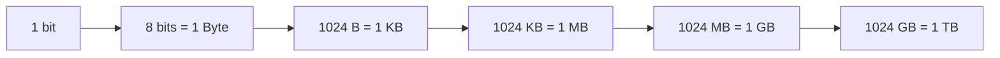
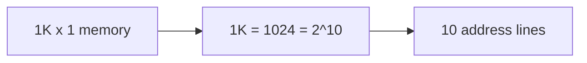

[[00 Computer Vault Index]]

# Number Systems & Math Corner

#computer #math

**8 questions** · 🟢 5 · 🟡 1 · 🔴 2

## Concept core

**Unit ladder**

**Addressing rule:** `n` address lines reach `2^n` locations.

| Address lines | Locations |
|---|---|
| 10 | 1 K |
| 16 | 64 K |
| 20 | 1 MB |
| 32 | 4 GB |

**Q105 step by step (associative cache)**

1. Main memory 8K bytes: 8K = 2^13, so address = **13 bits**
2. Data per word = 1 byte = **8 bits**
3. Associative mapping stores address + data in each cache word
4. 13 + 8 = **21 bits**

**Capacity depends on the address bus only** (Q107: 32-bit address = 2^32 = 4 GB).

**Symbols:** `n` bits give `2^n` symbols. 8 bits = 256 (ASCII extended). 7 bits = 128.

**12 GB in bytes:** 12 x 1024 x 1024 x 1024 = 12,884,901,888.

## Q&A: answer first, then open the Answer callout

Ordered easy to hard. Level is shown **before** the answer. 🔁 = repeated in your paper. ⚠️ = doubtful key, see [[12 Doubtful Keys]].

### Q167 · 🟢 Easy
1Kb (1024 bit) memory organised as 1Kx1: number of address lines needed:  
a) 6  
b) 10  
c) 14  
d) 18

> [!success]- Answer
> **b) 10**
> 1K = 1024 = 2^10 locations, so 10 address lines. (x1 means 1 bit per location.)

### Q473 · 🟢 Easy
A bit stands for:  
a) Binary Digit  
b) Binary Data  
c) Binary Deci  
d) Binary Code

> [!success]- Answer
> **a) Binary Digit**
> BInary digiT.

### Q614 · 🟢 Easy
Unit of data eight binary digits long:  
a) Bits  
b) Bytes  
c) Kilobytes  
d) Megabytes

> [!success]- Answer
> **b) Bytes**
> 8 bits = 1 byte.

### Q804 · 🟢 Easy
8-bit binary can represent how many symbols:  
a) 128  
b) 256  
c) 512  
d) 1024

> [!success]- Answer
> **b) 256**
> 2^8 = 256.

### Q837 · 🟢 Easy
One keystroke generates 1 ___ of data:  
a) Bit  
b) Byte  
c) Kilobyte  
d) Gigabyte

> [!success]- Answer
> **b) Byte**
> 1 character = 1 byte (ASCII).

### Q107 · 🟡 Medium
Maximum addressing capacity of a microprocessor with 16-bit data bus and 32-bit address bus:  
a) 64 K  
b) 4 GB  
c) both a & b  
d) None

> [!success]- Answer
> **b) 4 GB**
> Capacity depends on the ADDRESS bus only: 2^32 = 4 GB. The 16-bit data bus is a distraction (64K would be 16 address bits).

### Q105 · 🔴 Hard
Main memory is 8K bytes, cache is 2K words, associative mapping. Each word of cache shall be:  
a) 11 bits  
b) 21 bits  
c) 16 bits  
d) 20 bits

> [!success]- Answer
> **b) 21 bits**
> See Math Corner. Address = 13 bits (8K = 2^13), data = 8 bits (byte). Associative mapping stores full address + data in each cache word: 13 + 8 = 21.

### Q694 · 🔴 Hard
Bytes equivalent to 12 GB:  
a) 1024  
b) 12 x 1024  
c) 1024 x 1024 x 1024  
d) 1024

> [!success]- Answer
> **b) 12 x 1024** ⚠️
> Correct maths = 12 x 1024 x 1024 x 1024 = 12,884,901,888 bytes, which is not listed. (b) is the closest/usual key.

> [!warning] Exam Trap ⚠️
> - Address bus width sets capacity; data bus width does not.
> - 1K x 1 = **1024 locations**, so 10 lines (the x1 is bits per location).

## Self-check
- [ ] Round 1 score: __ / 8
- [ ] Round 2 (next day): __ / 8
- [ ] Round 3 (after 3 days): __ / 8
- Close topic at **85%**. Log in [[15 Progress Tracker]].
